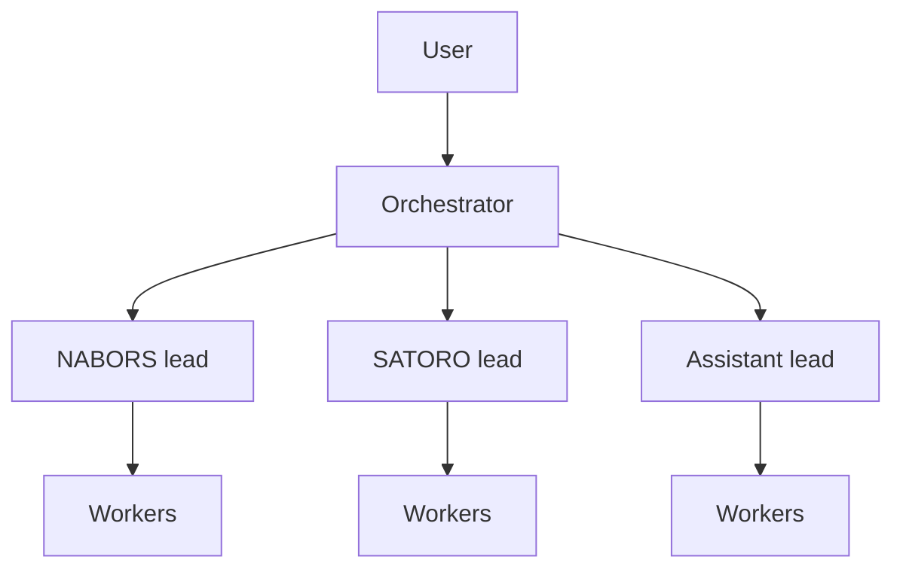
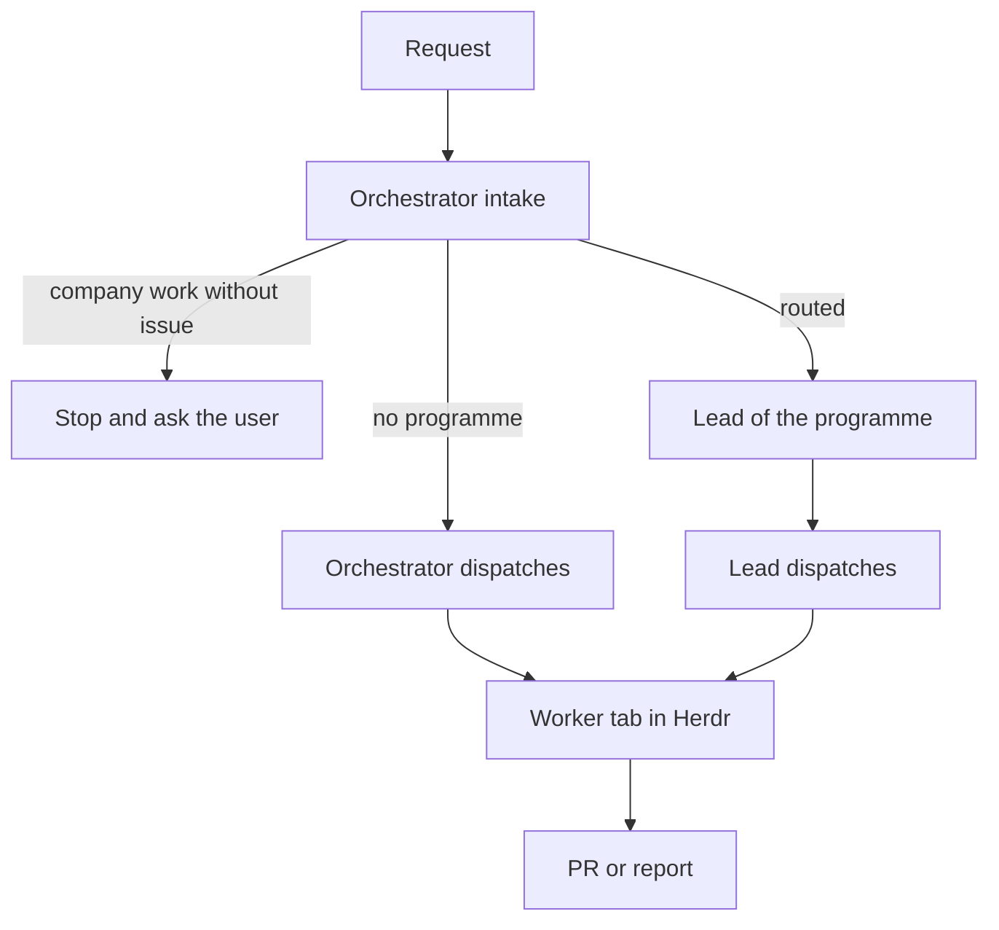
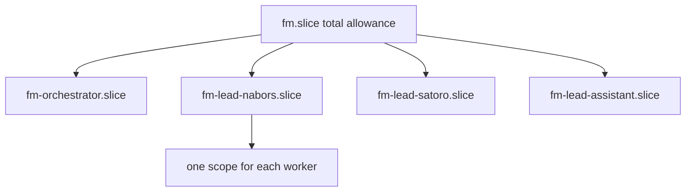

# Altave fork of Firstmate

This document is the authority for the Altave fork of Firstmate.
Where an upstream document conflicts with this document, this document applies.
Upstream is <https://github.com/kunchenguid/firstmate>.
The fork is <https://github.com/altave-guilherme-monteiro/firstmate>.

Each section has a status.
**Active** means that the fork code or rules do it now.
**Planned** means that the fork accepted it, but the work is not complete.

## Identity and vocabulary - Active for text, Planned for AGENTS.md rewrite

The agent is the **Orchestrator**, not a ship officer.
All text uses an impersonal voice.
Do not use names of persons, forms of address, or nautical words in files, reports, issues, PRs, or commits.

Internal identifiers do not change, because upstream uses them and a rename makes each upstream merge conflict.
This table maps each identifier to its fork meaning.

| Identifier in code and upstream text | Fork meaning |
|---|---|
| captain, `data/captain.md`, `fm-captain-hold.sh` | the user, user preferences, a decision for the user |
| firstmate, `fm-*` | the Orchestrator |
| secondmate, `kind=secondmate`, `data/secondmates.md` | a lead |
| crewmate | a worker |
| scout | an investigation |
| ship (task kind) | a change |
| `Captain, shipshape.` | `No action needed.` |

## Writing standard - Active

All English text for persons obeys ASD-STE100 Simplified Technical English.
This includes chat replies, reports, documents, issue text, PR descriptions, and commit messages.
Code identifiers, quoted error text, logs, and quoted words of the user stay unchanged.
Technical names and technical verbs of the field are permitted (for example `Herdr`, `worktree`, `PR`, `rebase`).
The main rules:

- One instruction in each sentence.
- An instruction sentence has a maximum of 20 words. A descriptive sentence has a maximum of 25 words.
- Use the active voice and the imperative for instructions.
- Use one word for one meaning, and one meaning for one word.
- Do not use idioms, slang, or decorative words.

The official specification is available from ASD at <https://www.asd-ste100.org/>.
The fork does not copy the specification or its dictionary.

## Roles - Planned

- The **Orchestrator** does intake, routing, the view across programmes, and maintenance of this fork.
- A **programme lead** is a technical project manager for one programme, as PMO defines it.
  It maintains the YouTrack issues, the Figma files, and the altave-systems-engineering documents of its programme.
  It dispatches and supervises workers for the work that the Orchestrator routes to it.
- The **assistant lead** manages small personal projects, personal mail, calendar, TickTick tasks, and the commitments of the user.
  It reads Altave Outlook and Teams.
  It does not need a YouTrack issue for personal work.
- The current leads are NABORS, SATORO, and the assistant.
- The `ops` lead was retired on 2026-10-31. Its open backlog moved to the Orchestrator home, and its reports are in `data/ops-archive-2026-10-31/` of that home.

## Dispatch rules - Planned

- Only the Orchestrator does intake and routing.
- A lead reports only to the Orchestrator. A lead does not send work to another lead.
- Work that a lead finds outside its programme goes back to the Orchestrator as a new item.
- The Orchestrator does not supervise the workers of a lead. It reads only the reports of the lead.
- Creating a YouTrack issue, changing a design for a client, and merging all need the approval of the user.

## Lead lifetime - Planned

- A lead starts when the Orchestrator routes work to it.
- A lead stops when its queue is empty and its workers are complete. Its home keeps all state.
- A lead is retired when PMO closes its programme. Retirement refuses while work is not complete.

## Runtime - Active

- The workspace is the Herdr app (Herdr.app on herdr-core), not the `herdr` terminal program.
- The runtime backend is therefore `hc` (`docs/hc-backend.md`). Each home sets `config/backend` to `hc`. tmux is not used for new work.
- Each task is an hc terminal with `herdr.space` and `herdr.tab` labels, so it shows as a tab in the Herdr.app space of its home.
- A tab takes its name from the terminal title.
- Upstream hc refuses leads. The fork removes that refusal, so a lead runs as an hc terminal and its workers show in the space of the lead home. Remove this fork change when upstream supports leads on hc.

## Resource allowances - Planned

Linux control groups (systemd user slices) enforce the allowances.
The allowances cascade: a child cannot use more than its parent.

- Each slice has `CPUQuota`, `MemoryHigh`, and `MemoryMax`.
- The launch of each agent and worker goes into the slice of its home.
- A dispatch refuses when the slice of the home has no free allowance.
- The Orchestrator and each lead read the use of their slice before each dispatch.
- A Herdr tab named `resources` shows the live use and the allowance of each slice.

## Brief additions - Active

`docs/fork/brief-include.md` contains the standing worker instructions of the fork: the code graph, the security scan, the library documentation, the no-mistakes rebase gate check, the rule that workers do not run services on this machine, and the PR review loop.
Each home links `config/brief-include.md` to that file.
Upstream `bin/fm-brief.sh` appends the file to each change and investigation brief.

## Fork additions - Active

| Addition | Files |
|---|---|
| YouTrack issue gate on change spawns (`--issue`, `--no-issue`) | `bin/fm-spawn.sh` |
| YouTrack board report at session start | `bin/fm-startup-network.sh`, `bin/fm-youtrack.sh` |
| Evidence posted to the issue | `bin/fm-evidence.sh` |
| Team routing of new issues | `bin/fm-team-routing.sh` |
| Architecture and decision documents mirrored to issues | `bin/fm-architecture-sync.sh` |
| Code graph | `bin/fm-graphify-setup.sh`, `.agents/skills/codebase-graph/` |
| Trace context to otel-cli | `bin/` otel-cli consumer |
| NABORS version skill | `.agents/skills/nabors-programme/` |
| User preference files change only by explicit instruction | `AGENTS.md`, `.agents/skills/stow/` |
| Brief additions | `docs/fork/brief-include.md` |
| Affected-only pull request CI (`--affected`, `--ci-scope`) | `bin/fm-test-run.sh`, `.github/workflows/ci.yml`, `docs/fm-test-portable-shards.md` |
| Leads on the hc backend | `bin/fm-spawn.sh`, `docs/hc-backend.md`, `docs/configuration.md` |
| Signed steering records, opt-in with `config/steer-signing` | `bin/fm-task-inbox-lib.sh`, `bin/fm-verify-steer.sh`, `bin/fm-brief.sh`, `docs/configuration.md` |

## Upstream rule - Active

- Merge upstream into a branch, not into `main`.
- Keep upstream structure. Put fork behavior in fork files or in small, marked changes.
- When upstream gives the same behavior, remove the fork version.
- Record each fork addition in the table above in the same PR.
- Merge to `main` only through a PR and the approval of the user.
